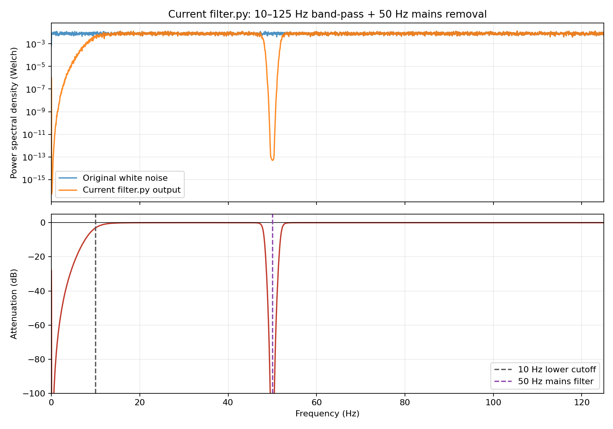

# Contributing

## Development Workflow

1. **Create a feature branch.** Branch from `main` using `feature/xyz`.
   [Super-Linter](.github/workflows/super-linter.yml) runs on pushes to
   `feature/**`; its checks must pass before merging into `main`.

2. **Follow the commit style.** Use `<type>: <short summary>`, with types such as
   `feat`, `fix`, `docs`, `ci`, or `chore`. Example:
   `docs: improve GUI animation quality`. See the
   [commit history](https://github.com/pareeknikhil/emg-gui/commits/main/).

3. **Pass the lint checks.** Use the [local commands below](#run-super-linter-locally)
   to run all linters or one specific linter. Push your commits to trigger
   Super-Linter and check the results in
   [GitHub Actions](https://github.com/pareeknikhil/emg-gui/actions).

4. **Open a PR into `main`.** Once checks pass, use a short, action-oriented title
   and a description covering what changed, why, and how you checked it. Follow
   the style of [existing PRs](https://github.com/pareeknikhil/emg-gui/pulls?q=is%3Apr).

5. **Link an issue when relevant.** You can
   [open an issue](https://github.com/pareeknikhil/emg-gui/issues/new) and reference
   it in the PR. Use `Closes #123` if merging the PR resolves the issue.

6. **Review and release.** The maintainer reviews and merges the PR. Only the
   maintainer creates and pushes release tags after merging into `main`. Tags
   trigger [release.yml](.github/workflows/release.yml) to build and publish to
   PyPI; follow the release status in
   [GitHub Actions](https://github.com/pareeknikhil/emg-gui/actions).

## Run Super-Linter Locally

### Run All Linters

From the project root, run all supported linters using Docker:

```bash
sudo docker run --rm \
  -e RUN_LOCAL=true \
  -e DEFAULT_BRANCH=main \
  -e VALIDATE_ALL_CODEBASE=true \
  -v "$PWD":/tmp/lint \
  ghcr.io/super-linter/super-linter:v8.7.0
```

### Run a Specific Linter

Set the relevant `VALIDATE_<LINTER_NAME>` environment variable to `true`. For
example, to run only Ruff:

```bash
sudo docker run --rm \
  -e RUN_LOCAL=true \
  -e DEFAULT_BRANCH=main \
  -e VALIDATE_ALL_CODEBASE=true \
  -e VALIDATE_PYTHON_RUFF=true \
  -v "$PWD":/tmp/lint \
  ghcr.io/super-linter/super-linter:v8.7.0
```

## Planned Features

### Live Frequency-Domain View

A future interface will add a live frequency-domain view rendered with ModernGL,
using the same GPU-based approach as the raw and filtered EMG time-series view.
The interface will show one selected EMG channel at a time with:

- raw and filtered Welch power spectral density (PSD) curves;
- an attenuation curve calculated from the filtered and raw PSDs;
- frequency and decibel axes, a channel selector, and a raw/filtered legend.

The existing filtering path will continue to run only once per snapshot. The raw
and filtered arrays will then be shared by the time-domain and frequency-domain
renderers. Welch calculations should be vectorized across channels, performed
only for new snapshots, and throttled to approximately 5–10 updates per second so
they do not delay the main Qt/OpenGL render loop. The resulting frequency and
power values will be uploaded to dynamic ModernGL buffers and drawn as line
strips using the existing line-shader approach.

The following white-noise measurement is a development reference for the
current filter configuration at a 250 Hz sampling rate with 50 Hz mains-noise
removal. The planned live interface should present the same two relationships:
raw versus filtered PSD and attenuation by frequency.



## Tech Debt

1. Add automatic ports detection script or options
2. Create new repo-emg-ability.
3. Folder portability use [EMGFlow](https://github.com/WiIIson/EMGFlow-Python-Package/tree/main) & [system path](https://www.youtube.com/watch?v=v6tALyc4C10&t=3s) reference.
4. Add legends for raw and filtered emg in timeseries renderer.
5. Processing latency in the performance metrics.
6. Add test coverage.
7. Improve the GUI toggle controls and expose their options in the left sidebar.
8. Add timer and countdown visualizations.
9. Move signal processing from the GUI thread to a dedicated processing thread.
10. Move the complete data-source lifecycle into the sensor thread, including initialization, streaming, recording, stopping, and release.
11. Implement the [live ModernGL frequency-domain view](#live-frequency-domain-view).
