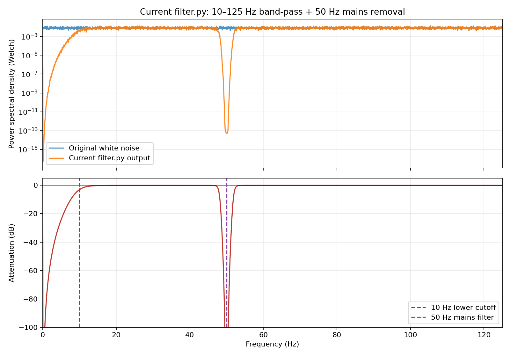

<h1 align="center">
  
  <br>
  EMG-GUI
  <br>
  <a href="https://pypi.org/project/emg-gui/"></a>
  <a href="https://pypi.org/project/emg-gui/"></a>
  <a href="https://pepy.tech/project/emg-gui"></a>
  <a href="https://pepy.tech/project/emg-gui"></a>
  <a href="https://github.com/pareeknikhil/emg-gui/releases"></a>
</h1>

<p align="center">
  <em>A high-performance, multithreaded, real-time visualization engine for acquiring, recording, and exploring raw and filtered EMG signals from OpenBCI boards.</em>
</p>

## 1. Overview

### 1.1 Installation

EMG-GUI can be installed from pypi using pip:

```bash
pip install emg-gui
```

### 1.2 How to Run

TODO

---

## 2. Architecture and Project Structure

### 2.1 Architecture

The application separates sensor acquisition, interface controls, signal
processing, and GPU rendering. Sensor polling and board stream control run on a
dedicated thread, while Qt interface updates, filtering, and ModernGL rendering
currently run on the main thread.

```text
EMG GUI
├── app.py
├── Acquisition
│   ├── DataSource
│   └── SensorWorker
│       └── RingBuffer
├── UI
│   ├── EMGVisualizerWindow
│   └── EMGControlPanel
├── Processing
│   ├── EMG filtering
│   └── Window functions
└── Visualization
    ├── EMGOpenGLWidget
    ├── TimeSeriesRenderer
    ├── SpectrogramRenderer
    ├── TicksRenderer
    └── TextRenderer
```

The `DataSource` provides hardware-independent acquisition from either an
OpenBCI board or a playback recording. The current application entry point uses
`OpenBCIBoard` by default, with playback available as an alternate source.
`SensorWorker` reads EMG samples into a fixed-size ring buffer, and
`EMGOpenGLWidget` owns duplicate-snapshot checks, snapshot filtering, and
ModernGL rendering. `TimeSeriesRenderer` and `SpectrogramRenderer` are connected
to the live rendering path. Channel counts come from the selected data source,
so synthetic and real boards can expose different numbers of EMG channels. The
display window is sample-based, while the rendered layout is derived from the
OpenGL widget size and the selected EMG channel count.

See the [architecture guide](docs/architecture.md) for the detailed component
hierarchy, data flow, and thread interaction sequences.

### 2.2 Directory Layout

Inside this project, you'll see the following folders and files:

```text
/
├── docs/
│   ├── diagrams/
│   │   ├── Ability_Logo.svg
│   │   ├── current-filter-frequency-response.png
│   │   └── interface-contracts.svg
│   └── architecture.md
├── src/
│   └── emg_gui/
│       ├── app.py
│       ├── acquisition/
│       │   ├── data_source.py
│       │   ├── dataset_files.py
│       │   └── sensor_worker.py
│       ├── config/
│       │   ├── constants.py
│       │   └── Roboto-Black.ttf
│       ├── core/
│       │   ├── enums.py
│       │   ├── logger.py
│       │   └── types.py
│       ├── processing/
│       │   ├── filter.py
│       │   └── window_functions.py
│       ├── ui/
│       │   ├── control_panel.py
│       │   └── window.py
│       └── visualizer/
│           ├── shaders/
│           │   ├── shader_loader.py
│           │   ├── spec/
│           │   │   ├── vertex.glsl
│           │   │   └── fragment.glsl
│           │   ├── text/
│           │   │   ├── vertex.glsl
│           │   │   └── fragment.glsl
│           │   ├── ticks/
│           │   │   ├── vertex.glsl
│           │   │   └── fragment.glsl
│           │   └── time_series/
│           │       ├── vertex.glsl
│           │       └── fragment.glsl
│           ├── open_gl_widget.py
│           ├── spectrogram_renderer.py
│           ├── text_renderer.py
│           ├── ticks_renderer.py
│           └── time_series_renderer.py
├── tests/
├── CONTRIBUTING.md
├── pyproject.toml
└── README.md
```

### 2.3 Planned Live Frequency-Domain View

A future interface will add a live frequency-domain view rendered with ModernGL,
using the same GPU-based approach as the raw and filtered EMG time-series view.
The interface will show one selected EMG channel at a time with:

- raw and filtered Welch power spectral density (PSD) curves;
- an attenuation curve calculated from the filtered and raw PSDs;
- frequency and decibel axes, a channel selector, and a raw/filtered legend.

The existing filtering path will continue to run only once per snapshot. The raw
and filtered arrays will then be shared by the time-domain and frequency-domain
renderers. Welch calculations should be vectorized across channels, performed
only for new snapshots, and throttled to approximately 5–10 updates per second so
they do not delay the main Qt/OpenGL render loop. The resulting frequency and
power values will be uploaded to dynamic ModernGL buffers and drawn as line
strips using the existing line-shader approach.

The following white-noise measurement is a development reference for the
current filter configuration at a 250 Hz sampling rate with 50 Hz mains-noise
removal. The planned live interface should present the same two relationships:
raw versus filtered PSD and attenuation by frequency.



---

## 3. Contributing

Contributions are welcome! See the [contributing guide](CONTRIBUTING.md) for
development and linting guidelines.

---

## 4. Acknowledgements

### 4.1 BrainFlow

This project uses [BrainFlow](https://brainflow.readthedocs.io/en/stable/) for
biosignal acquisition and hardware integration. BrainFlow provides a uniform
API for acquiring, parsing, and analyzing EEG, EMG, ECG, and other biosensor
data across a wide range of supported boards, including OpenBCI devices.
BrainFlow is distributed under the
[MIT License](https://github.com/brainflow-dev/brainflow/blob/master/LICENSE).

### 4.2 ModernGL Spectrogram

This project uses
[nickcercone/spectrogram](https://github.com/nickcercone/spectrogram) as a
reference for parts of its ModernGL spectrogram rendering implementation. The
referenced project demonstrates real-time audio spectrogram visualization
using ModernGL and is distributed under the
[MIT License](https://github.com/nickcercone/spectrogram/blob/main/LICENCE).

### 4.3 Text Rendering

This project adapts the code in
[How to render text with PyOpenGL?](https://stackoverflow.com/questions/63836707/how-to-render-text-with-pyopengl)
by exiled (question) and Rabbid76 (answer) for its ModernGL text renderer.
The referenced contributions demonstrate text rendering with PyOpenGL and are
distributed under the
[CC BY-SA 4.0 License](https://creativecommons.org/licenses/by-sa/4.0/).

---

## 5. Tech Debt

1. Add setup and installation instructions to this readme.
2. Create new repo-emg-ability.
3. Folder portability use [EMGFlow](https://github.com/WiIIson/EMGFlow-Python-Package/tree/main) & [system path](https://www.youtube.com/watch?v=v6tALyc4C10&t=3s) reference.
4. Add legends for raw and filtered emg in timeseries renderer.
5. Processing latency in the performance metrics.
6. Improve the GUI toggle controls and expose their options in the left sidebar.
7. Add timer and countdown visualizations.
8. Move signal processing from the GUI thread to a dedicated processing thread.
9. Move the complete data-source lifecycle into the sensor thread, including initialization, streaming, recording, stopping, and release.
10. Implement the [live ModernGL frequency-domain view](#23-planned-live-frequency-domain-view).
