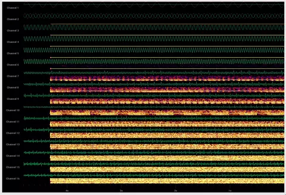

<h1 align="center">
  
  <br>
  EMG-GUI
  <br>
  <a href="https://pypi.org/project/emg-gui/"></a>
  <a href="https://pypi.org/project/emg-gui/"></a>
  <a href="https://pepy.tech/project/emg-gui"></a>
  <a href="https://pepy.tech/project/emg-gui"></a>
  <a href="https://github.com/pareeknikhil/emg-gui/releases"></a>
</h1>

<p align="center">
  <em>Real-time acquisition and visualization of OpenBCI EMG signals with Python.</em>
</p>

EMG-GUI is a multithreaded [Python package](https://pypi.org/project/emg-gui/) built with BrainFlow, Qt, and
ModernGL. It displays raw and filtered EMG traces from OpenBCI boards alongside
a live spectrogram, with support for recording and playback.

<p align="center">
  
</p>

## Contents

- [Installation](#1-installation)
- [Practical Examples](#2-practical-examples)
- [Configuration](#configuration)
- [Architecture](#3-architecture)
- [Contributing](#4-contributing)
- [Planned Features](CONTRIBUTING.md#planned-features)
- [Tech Debt](CONTRIBUTING.md#5-tech-debt)
- [Acknowledgements](#5-acknowledgements)
- [Videos](#videos)

## 1. Installation

**Requirement:** Python 3.9, 3.10, 3.11, 3.12, 3.13, or 3.14.

Choose your operating system and follow the steps in order.

<details>
<summary><strong>🍎 macOS</strong></summary>

1. **Install EMG-GUI:**

   ```bash
   pip install emg-gui
   ```

</details>

<details>
<summary><strong>🪟 Windows</strong></summary>

1. **Install EMG-GUI in PowerShell:**

   ```powershell
   pip install emg-gui
   ```

</details>

<details open>
<summary><strong>🐧 Linux — Ubuntu / Debian</strong></summary>

1. **Install the system dependencies.** For Debian and Ubuntu:

   ```bash
   sudo apt update
   sudo apt install \
     libgl-dev \
     libegl-dev \
     libxcb-icccm4 \
     libxcb-keysyms1 \
     libxcb-xinerama0 \
     libxcb-xkb1 \
     libxkbcommon-x11-0
   ```

2. **Install EMG-GUI:**

   ```bash
   pip install emg-gui
   ```

</details>

<br>

> **Graphics troubleshooting:** If the application reports an OpenGL context
> error, check that your graphics driver provides OpenGL 3.3 or later.

## 2. Practical Examples

Each script opens raw and filtered EMG traces alongside a live spectrogram.
Run it with Python, then click **Stream Data** to begin. Close the window to exit.

- [Synthetic data](#synthetic-data): try the interface without hardware.
- [OpenBCI Cyton](#openbci-cyton): connect a serial board.
- [Playback](#playback): view a bundled or personal recording.
- [Configuration](#configuration): board types, connection options, and mains frequency.

### Synthetic data

[Source: examples/synthetic_board.py](examples/synthetic_board.py)

```python
from emg_gui import (
    ConsoleLogger, EMGVisualizerWindow, MainsFrequency,
    OpenBCIBoard, OpenBCIBoardType, OpenBCIConfig,
)


def main():
    logger = ConsoleLogger()
    board = None
    try:
        config = OpenBCIConfig(board_type=OpenBCIBoardType.SYNTHETIC)
        board = OpenBCIBoard(logger=logger, config=config)
        EMGVisualizerWindow.run(
            logger=logger, board=board, mains_frequency=MainsFrequency.FIFTY_HZ
        )
    finally:
        if board is not None:
            board.release()
        logger.release()


if __name__ == "__main__":
    main()
```

### OpenBCI Cyton

[Source: examples/cyton_board.py](examples/cyton_board.py)

Set `serial_port` in the example below to your board's port:

- **macOS:** use `/dev/cu.*`, such as `/dev/cu.usbserial-…`.
- **Windows:** use the assigned COM port, such as `COM3`.
- **Ubuntu / Debian:** use `/dev/ttyUSB0` or `/dev/ttyACM0`. To grant serial-port
  access, run the following, then sign out and back in:

  ```bash
  sudo usermod -aG dialout "$USER"
  ```

```python
from emg_gui import (
    ConsoleLogger, EMGVisualizerWindow, MainsFrequency,
    OpenBCIBoard, OpenBCIBoardType, OpenBCIConfig,
)


def main():
    logger = ConsoleLogger()
    board = None
    try:
        config = OpenBCIConfig(
            board_type=OpenBCIBoardType.CYTON_SERIAL,
            serial_port="/dev/ttyUSB0",
            polling_interval_ms=40,
            turn_off_srb=True,
        )
        board = OpenBCIBoard(logger=logger, config=config)
        EMGVisualizerWindow.run(
            logger=logger, board=board, mains_frequency=MainsFrequency.FIFTY_HZ
        )
    finally:
        if board is not None:
            board.release()
        logger.release()


if __name__ == "__main__":
    main()
```

### Playback

[Source: examples/playback_recording.py](examples/playback_recording.py)

No board connection is needed. Set `board_type` to the board used for the
recording; it determines the playback sampling rate. The bundled example uses `SYNTHETIC`.

```python
from importlib.resources import files

from emg_gui import (
    ConsoleLogger, EMGVisualizerWindow, MainsFrequency,
    OpenBCIBoardType, PlayBackConfig, PlaybackRecording,
)


def main():
    logger = ConsoleLogger()
    board = None
    try:
        recording = files("emg_gui.data") / "train" / "top_fist" / "file_1.csv"
        # For your own recording, use its path instead:
        # recording = "/home/user/recordings/session.csv"
        config = PlayBackConfig(
            board_type=OpenBCIBoardType.SYNTHETIC,
            file_path=str(recording),
            polling_interval_ms=40,
        )
        board = PlaybackRecording(logger=logger, config=config)
        EMGVisualizerWindow.run(
            logger=logger, board=board, mains_frequency=MainsFrequency.FIFTY_HZ
        )
    finally:
        if board is not None:
            board.release()
        logger.release()


if __name__ == "__main__":
    main()
```

**File format:** numeric, tab-separated rows without a header. Each row is one
sample; columns contain EMG channels followed by one marker column. Use zeros
in the marker column when there are no markers. Relative paths resolve from
your working directory. Playback outputs zeros after the last sample; stop and
restart streaming to replay from the beginning.

### Configuration

`OpenBCIConfig` and `PlayBackConfig` are immutable. Create a new configuration
and data-source instance to change their settings.

**`OpenBCIConfig`**

| Parameter                      | Default  | Purpose                                                                                                 |
| ------------------------------ | -------- | ------------------------------------------------------------------------------------------------------- |
| `board_type: OpenBCIBoardType` | Required | Select the board and its sampling rate/channel layout.                                                  |
| `polling_interval_ms: int`     | `40`     | Interval between data reads; does not change the board's sampling rate.                                 |
| `turn_off_srb: bool`           | `False`  | Send SRB-disabling channel commands for a compatible Cyton setup. Leave disabled for other board types. |
| `serial_port: str`             | `""`     | Serial device path or COM port.                                                                         |
| `ip_address: str`              | `""`     | Board/network address.                                                                                  |
| `ip_port: int`                 | `0`      | Network port.                                                                                           |
| `ip_protocol: int`             | `0`      | BrainFlow IP protocol value.                                                                            |
| `mac_address: str`             | `""`     | Device MAC address, when required.                                                                      |
| `serial_number: str`           | `""`     | Device serial number, when required.                                                                    |
| `timeout: int`                 | `0`      | BrainFlow discovery/connection timeout.                                                                 |
| `other_info: str`              | `""`     | Additional board-specific connection information.                                                       |

Connection fields are passed directly to BrainFlow. Supply the fields required
by your board's [connection instructions](https://brainflow.readthedocs.io/en/stable/SupportedBoards.html).

**`OpenBCIBoardType`**

| Connection       | Enum members                                            |
| ---------------- | ------------------------------------------------------- |
| Serial / dongle  | `CYTON_SERIAL`, `CYTON_DAISY_SERIAL`, `GANGLION_DONGLE` |
| Native Bluetooth | `GANGLION_NATIVE`                                       |
| Wi-Fi            | `CYTON_WIFI`, `CYTON_DAISY_WIFI`, `GANGLION_WIFI`       |
| Generated data   | `SYNTHETIC`                                             |

**`PlayBackConfig`**

| Parameter                      | Default  | Purpose                                                                    |
| ------------------------------ | -------- | -------------------------------------------------------------------------- |
| `board_type: OpenBCIBoardType` | Required | Board whose sampling rate matches the recording.                           |
| `file_path: str`               | `""`     | Path to the recording; supply an existing file.                            |
| `polling_interval_ms: int`     | `40`     | Playback read interval; samples per read follow the board's sampling rate. |

**`EMGVisualizerWindow.run(logger, board, mains_frequency)`**

Pass a `ConsoleLogger`, an `OpenBCIBoard` or `PlaybackRecording`, and either
`MainsFrequency.FIFTY_HZ` or `MainsFrequency.SIXTY_HZ` for mains-noise removal.
Use the enum members, not the numbers `50` or `60`. This call creates the Qt
application and blocks until the window closes. Run it on the main thread;
release the board and logger afterwards, as shown above.

## 3. Architecture

See the [architecture guide](docs/architecture.md) for the component overview,
[directory layout](docs/architecture.md#directory-layout), data flow, and thread
interactions.

## 4. Contributing

Contributions are welcome! See [CONTRIBUTING.md](CONTRIBUTING.md) for the development and linting workflow,
[planned features](CONTRIBUTING.md#planned-features), and
[tech debt](CONTRIBUTING.md#5-tech-debt).

Report reproducible problems through
[GitHub Issues](https://github.com/pareeknikhil/emg-gui/issues), including your
operating system, Python and package versions, and the full error output.

---

## 5. Acknowledgements

### 5.1 BrainFlow

This project uses [BrainFlow](https://brainflow.readthedocs.io/en/stable/) for
biosignal acquisition and hardware integration. BrainFlow provides a uniform
API for acquiring, parsing, and analyzing EEG, EMG, ECG, and other biosensor
data across a wide range of supported boards, including OpenBCI devices.
BrainFlow is distributed under the
[MIT License](https://github.com/brainflow-dev/brainflow/blob/master/LICENSE).

### 5.2 ModernGL Spectrogram

This project uses
[nickcercone/spectrogram](https://github.com/nickcercone/spectrogram) as a
reference for parts of its ModernGL spectrogram rendering implementation. The
referenced project demonstrates real-time audio spectrogram visualization
using ModernGL and is distributed under the
[MIT License](https://github.com/nickcercone/spectrogram/blob/main/LICENCE).

### 5.3 Text Rendering

This project adapts the code in
[How to render text with PyOpenGL?](https://stackoverflow.com/questions/63836707/how-to-render-text-with-pyopengl)
by exiled (question) and Rabbid76 (answer) for its ModernGL text renderer.
The referenced contributions demonstrate text rendering with PyOpenGL and are
distributed under the
[CC BY-SA 4.0 License](https://creativecommons.org/licenses/by-sa/4.0/).

## Videos

Watch demos and tutorials on [EMGAbility on YouTube](https://www.youtube.com/@EMGAbility).
