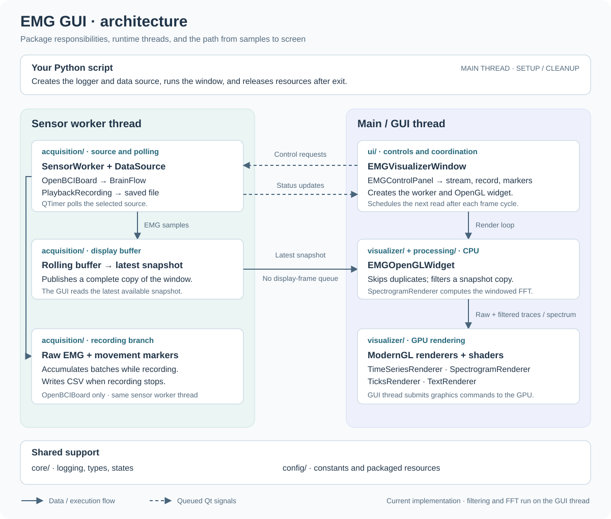
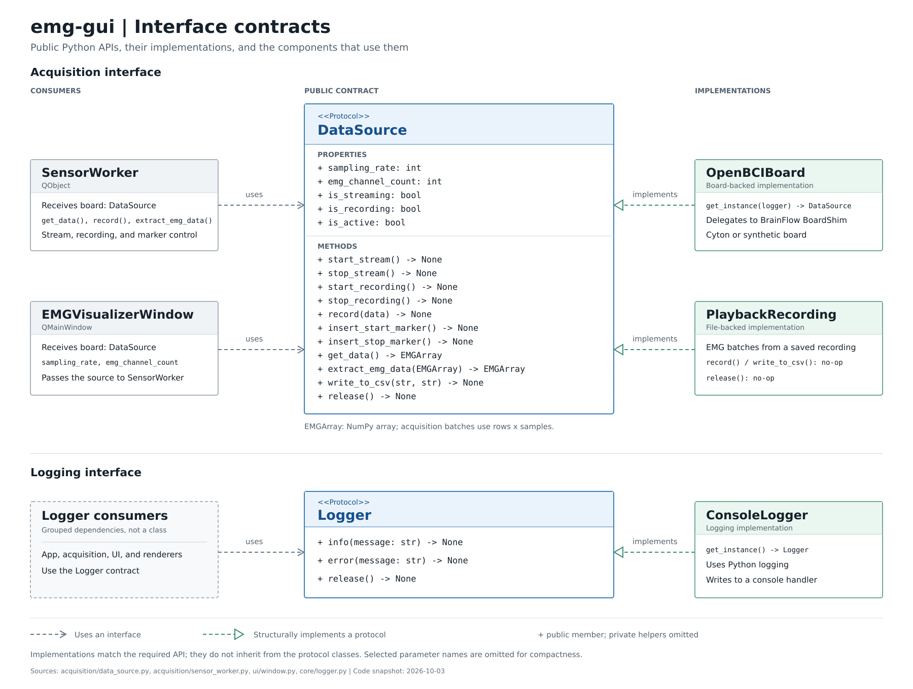

# User Guide

Examples and configuration for the public Python API, followed by the
[architecture overview](#3-architecture-overview).

## Contents

1. [Usage](#1-usage) — runnable examples and GUI controls
2. [API reference](#2-api-reference) — classes, parameters, and defaults
3. [Architecture](#3-architecture-overview) — components and thread boundaries
4. [Current limitations](#4-current-limitations) — incomplete and planned behavior

---

## 1. Usage

### Examples

[Synthetic board](#synthetic-board) · [Cyton serial board](#cyton-serial-board) · [Playback](#playback)

Each example is standalone. Save it as a Python script and run it after
installing `emg-gui`.

#### Synthetic board

Run without hardware using BrainFlow-generated signals. Click **Stream Data**
in the GUI to start. Each channel shows raw and filtered waveforms alongside
its spectrogram.

[Complete script](../examples/synthetic_board.py)

<details>
<summary>Show complete synthetic board example</summary>

```python
from emg_gui import (
    ConsoleLogger,
    EMGVisualizerWindow,
    MainsFrequency,
    OpenBCIBoard,
    OpenBCIBoardType,
    OpenBCIConfig,
)

logger = ConsoleLogger()
try:
    board = OpenBCIBoard(
        logger=logger,
        # Generate demo signals without connecting hardware.
        config=OpenBCIConfig(board_type=OpenBCIBoardType.SYNTHETIC),
    )
    try:
        EMGVisualizerWindow.run(
            logger=logger,
            board=board,
            # Use SIXTY_HZ where the local mains supply is 60 Hz.
            mains_frequency=MainsFrequency.FIFTY_HZ,
        )
    finally:
        # Release the board session even if the GUI raises an error.
        board.release()
finally:
    logger.release()
```

</details>

#### Cyton serial board

Connect a Cyton board through its serial dongle. Set your port before running.

[Complete script](../examples/cyton_board.py)

<details>
<summary>Show complete cyton board example</summary>

```python
from emg_gui import (
    ConsoleLogger,
    EMGVisualizerWindow,
    MainsFrequency,
    OpenBCIBoard,
    OpenBCIBoardType,
    OpenBCIConfig,
)

logger = ConsoleLogger()
try:
    config = OpenBCIConfig(
        board_type=OpenBCIBoardType.CYTON_SERIAL,
        # Replace with your dongle's port (for example, COM3 on Windows).
        serial_port="/dev/ttyUSB0",
        # Enable only if your board and electrode setup require SRB disabled.
        turn_off_srb=True,
    )
    board = OpenBCIBoard(logger=logger, config=config)
    try:
        EMGVisualizerWindow.run(
            logger=logger,
            board=board,
            mains_frequency=MainsFrequency.FIFTY_HZ,
        )
    finally:
        board.release()
finally:
    logger.release()
```

</details>

Set your board's actual port: `COM3` on Windows, `/dev/cu.usbserial-…` on
macOS, or `/dev/ttyUSB0` on Linux. Enable `turn_off_srb` only when appropriate
for your board and electrode setup.

#### Playback

Replay the bundled recording, or replace its path with your own file.

[Complete script](../examples/playback_recording.py)

<details>
<summary>Show complete playback recording example</summary>

```python
from importlib.resources import files

from emg_gui import (
    ConsoleLogger,
    EMGVisualizerWindow,
    MainsFrequency,
    OpenBCIBoardType,
    PlayBackConfig,
    PlaybackRecording,
)

# Locate the sample inside the installed package.
recording = files("emg_gui.data") / "train" / "top_fist" / "file_1.csv"
# For your own recording: recording = "/path/to/session.csv"

logger = ConsoleLogger()
try:
    board = PlaybackRecording(
        logger=logger,
        config=PlayBackConfig(
            # For your own file, use its original board type for the sampling rate.
            board_type=OpenBCIBoardType.SYNTHETIC,
            file_path=str(recording),
        ),
    )
    try:
        EMGVisualizerWindow.run(
            logger=logger,
            board=board,
            mains_frequency=MainsFrequency.FIFTY_HZ,
        )
    finally:
        board.release()
finally:
    logger.release()
```

</details>

For your own file, select the original board type so playback uses its sampling
rate. Files must contain tab-separated numeric rows of samples, with EMG channels
first and the marker column last, without a header. Playback does not save new
recordings or insert markers into the file.

---

### GUI Controls

- **Stream Data / Streaming:** start or stop acquisition or playback.
- **Record / Recording:** start recording, then click again to save the CSV.
  Select a dataset split and recording folder first.
- **Start Movement / Stop Movement:** insert movement markers while streaming;
  record at the same time to save those markers.
- **Reset:** clear the acquisition display buffer. Full waveform and
  spectrogram reset is not yet connected; see [limitations](#4-current-limitations).

For board recordings, files are saved under
`data/<split>/<folder>/<timestamp>__<folder>.csv`, relative to where you run
Python. Ensure the destination directory exists. Stop recording before closing
the window; closing does not automatically save an active recording.

---

## 2. API Reference

EMG-GUI has three main classes:

- `OpenBCIBoard` reads signals from an OpenBCI board or generates synthetic
  signals through BrainFlow.
- `PlaybackRecording` reads a saved recording for playback.
- `EMGVisualizerWindow` displays the signals and provides streaming, recording,
  and movement-marker controls.

To connect a board, pass an `OpenBCIConfig` containing its `OpenBCIBoardType`
and connection settings to `OpenBCIBoard`. For playback, pass a `PlayBackConfig`
containing the recording path and original board type to `PlaybackRecording`.

Pass either source to `EMGVisualizerWindow.run()` with a shared `ConsoleLogger`
and your local `MainsFrequency`. The same GUI works with either source.

Import these classes and enums directly from `emg_gui`.

**Board setup:** [OpenBCIConfig](#openbciconfig) · [OpenBCIBoardType](#openbciboardtype)  
**Playback:** [PlayBackConfig](#playbackconfig) · [Data sources](#openbciboard-and-playbackrecording)  
**Application:** [EMGVisualizerWindow](#emgvisualizerwindow) · [MainsFrequency](#mainsfrequency) · [ConsoleLogger](#consolelogger)

### OpenBCIConfig

`OpenBCIConfig(board_type, ...)` — immutable board configuration.

Create a new configuration to change connection settings. The board type
determines the channel count and sampling rate; you do not set these separately.

| Parameter             | Type               | Default  | Purpose                                                             |
| --------------------- | ------------------ | -------- | ------------------------------------------------------------------- |
| `board_type`          | `OpenBCIBoardType` | Required | Board and connection type.                                          |
| `polling_interval_ms` | `int`              | `40`     | Sensor polling interval; does not change the board's sampling rate. |
| `turn_off_srb`        | `bool`             | `False`  | Send SRB-disable commands during board setup.                       |
| `serial_port`         | `str`              | `""`     | Serial port selected by the user.                                   |
| `ip_address`          | `str`              | `""`     | Board IP address.                                                   |
| `ip_port`             | `int`              | `0`      | Network port.                                                       |
| `ip_protocol`         | `int`              | `0`      | BrainFlow IP protocol identifier.                                   |
| `mac_address`         | `str`              | `""`     | Device MAC address.                                                 |
| `serial_number`       | `str`              | `""`     | Device serial number.                                               |
| `other_info`          | `str`              | `""`     | Additional board-specific connection information.                   |
| `timeout`             | `int`              | `0`      | BrainFlow connection/discovery timeout in seconds.                  |

Connection fields are passed to BrainFlow. Set only those needed by your
[selected board](https://brainflow.readthedocs.io/en/stable/SupportedBoards.html).

### OpenBCIBoardType

| Member               | Source                            |
| -------------------- | --------------------------------- |
| `CYTON_SERIAL`       | Cyton over serial                 |
| `CYTON_DAISY_SERIAL` | Cyton Daisy over serial           |
| `GANGLION_DONGLE`    | Ganglion through a dongle         |
| `GANGLION_NATIVE`    | Ganglion through native Bluetooth |
| `CYTON_WIFI`         | Cyton over Wi-Fi                  |
| `CYTON_DAISY_WIFI`   | Cyton Daisy over Wi-Fi            |
| `GANGLION_WIFI`      | Ganglion over Wi-Fi               |
| `SYNTHETIC`          | BrainFlow-generated demo data     |

### PlayBackConfig

`PlayBackConfig(board_type, file_path="", polling_interval_ms=40)` — immutable
playback configuration.

| Parameter             | Type               | Default  | Purpose                                                  |
| --------------------- | ------------------ | -------- | -------------------------------------------------------- |
| `board_type`          | `OpenBCIBoardType` | Required | Original board type; determines playback sampling rate.  |
| `file_path`           | `str`              | `""`     | Path to a compatible recording; supply an existing file. |
| `polling_interval_ms` | `int`              | `40`     | Playback polling interval.                               |

### OpenBCIBoard and PlaybackRecording

- `OpenBCIBoard(logger, config: OpenBCIConfig)`: prepares a BrainFlow board session.
- `PlaybackRecording(logger, config: PlayBackConfig)`: loads a recording into memory.
- `release()`: releases the source after the GUI closes.

Pass the constructed source as `board` to `EMGVisualizerWindow.run()`.
The GUI handles streaming, recording, and movement controls.

Creating a source opens the board session or loads the file; it does not start
streaming. The examples use `finally` to release resources when the window
closes or an error occurs.

### EMGVisualizerWindow

`EMGVisualizerWindow.run(logger, board, mains_frequency)` starts the Qt GUI
and returns when it closes. Call it on the main thread.

| Parameter         | Value                                              |
| ----------------- | -------------------------------------------------- |
| `logger`          | The shared `ConsoleLogger` instance.               |
| `board`           | An `OpenBCIBoard` or `PlaybackRecording` instance. |
| `mains_frequency` | A `MainsFrequency` member; required.               |

### MainsFrequency

Use `MainsFrequency.FIFTY_HZ` or `MainsFrequency.SIXTY_HZ` to select mains-noise
suppression. Pass the enum member directly, without `.value`.

Choose the frequency of your local electricity supply, not the board's sampling
rate. This setting affects displayed filtering; saved recordings remain raw.

### ConsoleLogger

`ConsoleLogger()` creates the console logger. Use `info(message)` and
`error(message)` for messages; call `release()` during cleanup.

---

## 3. Architecture Overview

The diagram combines package responsibilities with runtime thread boundaries.
Acquisition and recording share a sensor worker thread; Qt controls, filtering,
FFT computation, and rendering coordination run on the main thread.



The GUI reads the latest rolling snapshot independently of sensor polling.
Recording collects raw samples and movement markers before display filtering.
Data-source setup and cleanup happen in the user's script on the main thread.

---

### Interface Contracts

The diagram shows the internal `DataSource` and `Logger` contracts and their
implementations. Normal usage requires only the classes imported in the examples.
Implementations satisfy these contracts through matching methods and properties;
they do not inherit from the protocol classes.



---

### Thread Model

| Operation                                            | Thread                                    |
| ---------------------------------------------------- | ----------------------------------------- |
| Construct logger and selected `DataSource`           | Main thread, before the Qt event loop     |
| Control-panel button handling                        | GUI thread                                |
| `SensorWorker.stream()` and `_receive_sensor_data()` | Sensor thread                             |
| Record, marker, and reset worker slots               | Sensor thread                             |
| Data-source stream control and `get_data()`          | Sensor thread during normal operation     |
| Read snapshot through `publish_buffer_snapshot()`    | GUI thread through a direct Python call   |
| Filtering, FFT, and array preparation                | GUI thread                                |
| `QOpenGLWidget` and ModernGL rendering               | GUI thread                                |
| Final board and logger release                       | Main thread after the Qt event loop exits |

---

## 4. Current Limitations

- **Reset is partial.** The Reset button clears the rolling buffer but does not
  publish a fresh snapshot immediately; the next sensor poll updates the
  waveforms. Stopping the stream already publishes a zero snapshot.
  `SpectrogramRenderer.reset()` exists, but the GUI does not call it.
  Connecting spectrogram reset and immediate waveform clearing remains to be done.
- **Processing shares the GUI thread.** Filtering and FFT computation can delay
  drawing. Moving them to a separate processing worker remains planned.
- **Recording stays in memory until saved.** CSV writing runs on the sensor
  worker when recording stops, temporarily delaying polling. Active recordings
  are not automatically saved on window close.
- **Playback controls are limited.** Recording and marker buttons do not create
  new files or edit markers. Playback produces zeros after the file ends;
  stopping and starting it replays from the beginning.
- **Spectrogram timing follows rendering.** History advances once per rendered
  slice, so its time progression depends on display speed.
- **Fixed display windows.** Waveform history and spectrogram analysis-window
  sizes are internal constants, not public configuration options.
- **Status overlays are planned.** Countdown, recording-state, and movement-marker
  overlays are not implemented. Current status feedback is through the control
  buttons.
